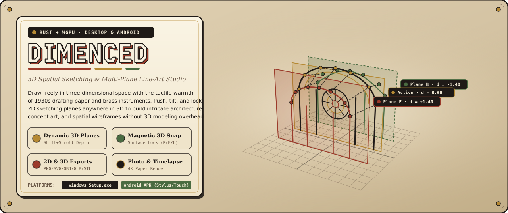
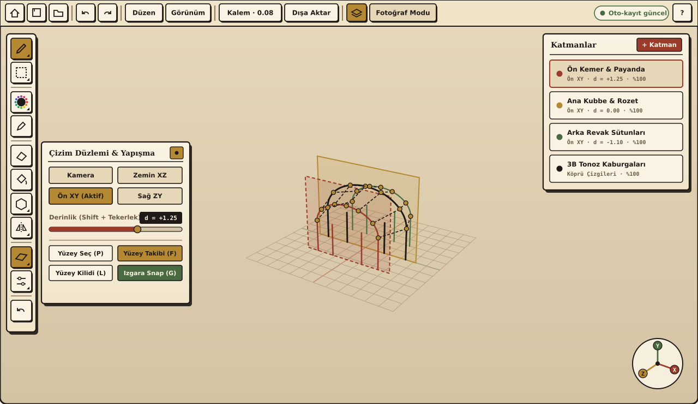
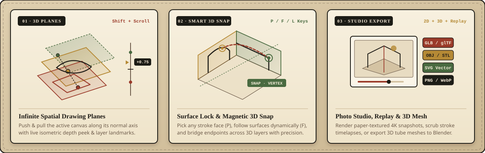

 

### **[⬇ Windows Installer (`Dimenced-Setup.exe`)](https://github.com/KaanAlper/Dimenced/releases/latest/download/Dimenced-Setup.exe)** &nbsp;·&nbsp; **[⬇ Android Universal APK (`Dimenced-universal.apk`)](https://github.com/KaanAlper/Dimenced/releases/latest/download/Dimenced-universal.apk)**

Android ABI Split Packages: <a href="https://github.com/KaanAlper/Dimenced/releases/latest/download/Dimenced-arm64-v8a.apk"><code>arm64-v8a</code></a> · <a href="https://github.com/KaanAlper/Dimenced/releases/latest/download/Dimenced-armeabi-v7a.apk"><code>armeabi-v7a</code></a> · <a href="https://github.com/KaanAlper/Dimenced/releases/latest/download/Dimenced-x86_64.apk"><code>x86_64</code></a>

---

## Overview

**Dimenced** is a hardware-accelerated **3D spatial sketching and multi-plane line-art studio** built in Rust (`eframe`/`egui` + `wgpu`). Designed with a tactile **1930s Kraft-Cardboard, Brass & Fountain-Ink** visual identity, it lets illustrators, concept artists, and architects draw 2D strokes directly onto dynamically positioned 3D planes—bridging the immediacy of pen-on-paper sketching with true three-dimensional perspective.

  

---

## Core Workflow

  

1. **Dynamic 3D Sketching Planes (`Shift + Scroll`)** — Push or pull the active drawing plane along its normal axis in real time. A clean isometric depth peek and minimal landmark ruler (`Origin > Plane > Stroke Endpoints`) let you align new layers with existing 3D geometry without visual clutter.
2. **Surface Lock & Magnetic 3D Snap (`P` / `F` / `L`)** — Pick any existing stroke's plane (`P`), follow surfaces dynamically as you draw (`F`), lock plane orientation (`L`), or hinge a new wall/roof plane at custom angles from an existing stroke boundary (`H`).
3. **Studio Photo Mode, Timelapse Replay & Multi-Format Export** — Frame your 3D drawing with paper-grain lighting in **Photo Mode**, scrub and replay every stroke in the **Timelapse Player**, or export to **2D raster/vector (`PNG`, `JPEG`, `WebP`, `SVG`)** and **3D meshes (`OBJ`, `glTF/GLB`, `STL`)** for Blender, CAD, or 3D printing.

---

## Key Features

| Category | Capabilities |
| :--- | :--- |
| **Drawing & Geometry** | Pressure-sensitive **Pen (`B`)**, **Eraser (`E`)**, **Line**, **Rectangle**, **Circle/Ellipse**, **3D Selection (`V`)**, **Move (`G`)**, **Rotate (`R`)**, **Scale (`S`)**, and real-time **Mirror / Symmetry** planes |
| **Spatial Plane System** | `XY` (Front), `XZ` (Ground), `YZ` (Side), camera-aligned planes, hinged planes (`H`), surface-follow mode (`F`), and per-layer independent 3D plane transforms |
| **Precision & Snapping** | 3D endpoint/midpoint magnetic snapping, axis & parallel inference guides, cross-plane endpoint bridging (`C`), and customizable 3D grid snapping |
| **Studio & Export** | **Photo Mode** with custom aspect ratios & paper backdrops, interactive **Timelapse Player**, and export to **PNG, JPEG, WebP, SVG, Wavefront OBJ, glTF 2.0 / GLB, and STL** |
| **Cross-Platform & Native** | Native **Windows (`DirectX 12 / Vulkan`)** with self-contained `Dimenced-Setup.exe` & background auto-updater, plus **Android (`Vulkan / GLES`)** with full stylus pressure & multi-touch navigation |

---

## Keyboard & Stylus Shortcuts

| Input | Action |
| :--- | :--- |
| **Left Drag / Stylus** | Draw stroke on active 3D plane (or transform selection) |
| **Middle Drag** / **Space + Left Drag** | Pan camera |
| **Right Drag** | Orbit 3D camera |
| **Scroll Wheel** | Dolly zoom toward cursor |
| **Shift + Scroll Wheel** | Offset active drawing plane depth (`d`) with live isometric peek |
| **B / E / V** | Pen / Eraser / Select tool |
| **P / F / L / H** | Pick stroke plane / Surface Follow / Surface Lock / Hinge plane |
| **1 / 3 / 7 / 5 / 0** | Front / Right / Top / Isometric / Reset camera view |
| **Ctrl + Z** / **Ctrl + Y** | Undo / Redo (`Command` history stack) |

---

## Privacy Policy & Links

- Privacy Policy: https://kaanalper.github.io/dimenced/PRIVACY.html
- Latest Downloads: https://github.com/KaanAlper/Dimenced/releases/latest

---

© Kaan Alper. All rights reserved.
